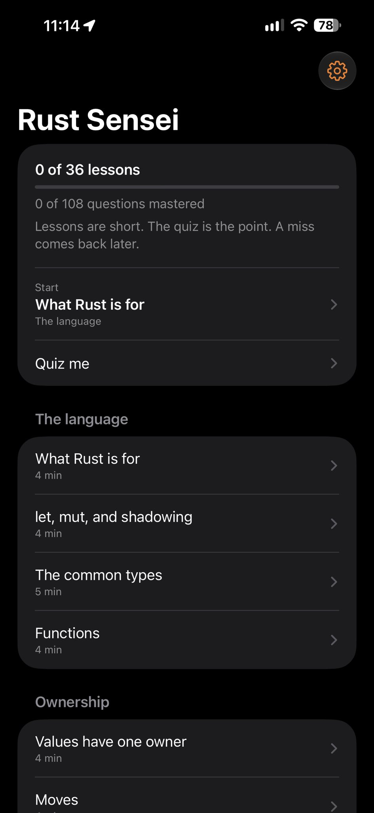
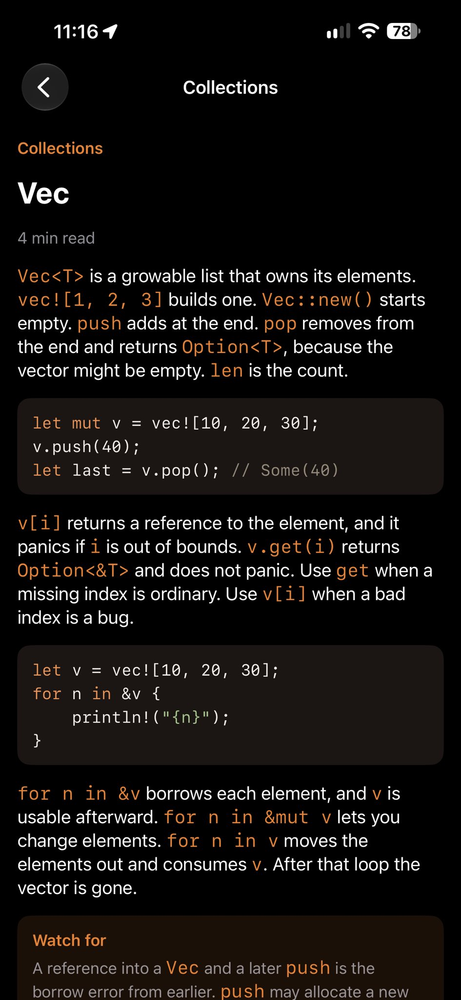
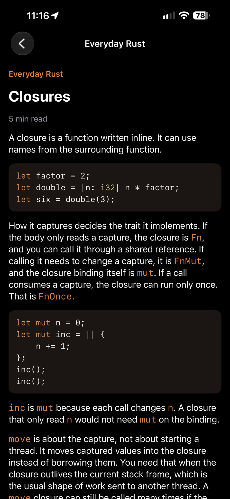
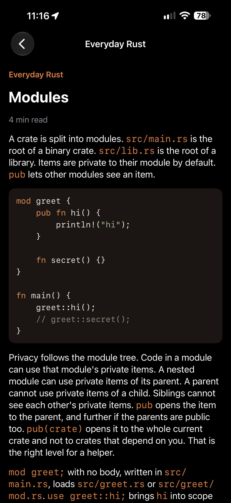

# Rust Sensei

An iPhone app that teaches Rust, then quizzes you on it.

Thirty-six short lessons cover the core of the language: types and functions, ownership, borrowing, `Option` and `Result`, structs and enums, collections, traits, errors, lifetimes, iterators, closures, and modules. Each lesson ends in three questions. A miss stays missed until you get it right. Review drills those. Quiz me re-asks questions you already got right, oldest first.

Nothing leaves the phone. Progress is on the device.

The course stops before async, macros, and unsafe. The Rust book is linked from Settings for what comes next.

## Screenshots






## Build and install

Signing and the phone you install on stay in `.env` on your machine.

```bash
cp .env.example .env
```

Edit `.env` and set `DEVELOPMENT_TEAM`, `PRODUCT_BUNDLE_IDENTIFIER`, `DEVICE_ID`, and `DEVICE_NAME`. Then:

```bash
./scripts/sync-config.sh
set -a
. ./.env
set +a

DD=/tmp/rust-sensei-dd
xcodebuild -project RustSensei.xcodeproj -scheme RustSensei -configuration Debug \
  -destination "id=$DEVICE_ID" \
  DEVELOPMENT_TEAM="$DEVELOPMENT_TEAM" \
  PRODUCT_BUNDLE_IDENTIFIER="$PRODUCT_BUNDLE_IDENTIFIER" \
  -derivedDataPath "$DD" -allowProvisioningUpdates build

APP="$DD/Build/Products/Debug-iphoneos/RustSensei.app"
xcrun devicectl device install app --device "$DEVICE_ID" "$APP"
xcrun devicectl device process launch --device "$DEVICE_ID" "$PRODUCT_BUNDLE_IDENTIFIER"
```

`scripts/sync-config.sh` writes `Config/Local.xcconfig` so the Xcode project uses the same team and bundle id. `.env` and `Config/Local.xcconfig` are gitignored.

Launch fails while the phone is locked. Install still succeeds. Unlock the phone and open Rust Sensei, or run the launch command again.

A compile check with no device and no signing:

```bash
xcodebuild -project RustSensei.xcodeproj -scheme RustSensei \
  -destination 'generic/platform=iOS' CODE_SIGNING_ALLOWED=NO build
```

The icon is drawn by `make_icon.swift`:

```bash
swift make_icon.swift RustSensei/Assets.xcassets/AppIcon.appiconset/AppIcon.png
```
